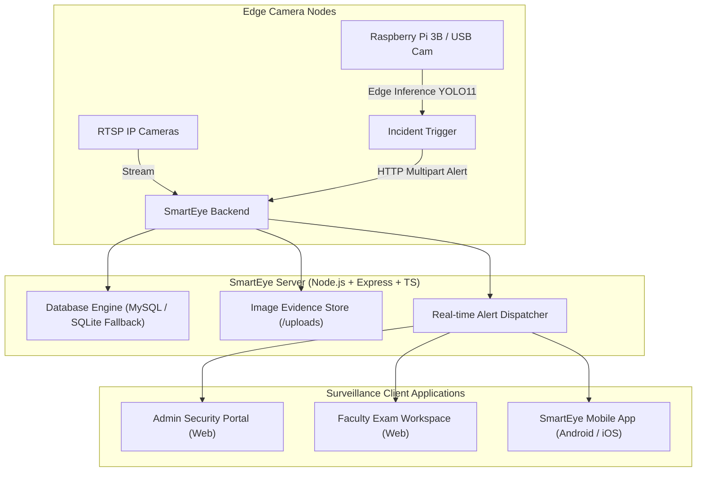

# 👁️ SmartEye — Smart AI Camera & Campus Surveillance System

[](https://react.dev/)
[](https://www.typescriptlang.org/)
[](https://vitejs.dev/)
[](https://tailwindcss.com/)
[](https://docs.ultralytics.com/)
[](https://capacitorjs.com/)
[](https://nodejs.org/)

**SmartEye** is an enterprise-grade AI-powered campus and examination surveillance ecosystem. It pairs high-accuracy **Edge AI Computer Vision (YOLO11)** on Raspberry Pi / IP camera nodes with a dual-portal command center for real-time unauthorized device detection, automated incident logging, and emergency campus communication.

---

## 📌 Project Highlights

* **Edge AI Mobile Device Detection**: Custom fine-tuned **YOLO11** model with multi-heuristic false-positive suppression (rejects ID badges, lanyards, and laptops via aspect ratio filtering and multi-frame temporal streak confirmation).
* **Dual-Portal Web Architecture**:
  * **Admin Infrastructure & Security Control Portal**: Node status monitoring, RTSP stream management, database backups, audit logging, and campus-wide emergency broadcast dispatch.
  * **Faculty & Exam Surveillance Portal**: Live multi-room classroom feeds, instant incident detection alerts, HD lightbox evidence viewer, and real-time faculty chat.
* **Edge Node Support**: Native deployment scripts for **Raspberry Pi 3B** / USB / RTSP IP camera streams.
* **Mobile Ready**: Cross-platform Android (`.apk`) and iOS builds powered by **Capacitor**.
* **Resilient Backend**: Node.js + Express with dual-engine persistence (MySQL with seamless in-memory / SQLite fallback).

---

## 🏗️ System Architecture



---

## 🚀 Key Features

### 1. 🛡️ Admin Security & Infrastructure Portal
- **Camera Node Manager**: Configure RTSP endpoints, physical locations, and sensitivity thresholds.
- **System Health Monitor**: Live memory, CPU, and database status indicators.
- **Audit Logging**: Comprehensive forensic logs for all administrative actions and security logins.
- **Database Dump & Backups**: One-click MySQL database dump generation and restoration.
- **Campus Emergency Dispatch**: Broadcast priority red alerts to all active faculty portals.

### 2. 👨‍🏫 Faculty Surveillance & Exam Workspace
- **Live Room Grid**: View real-time feeds from examination halls and lecture spaces.
- **Incident Lightbox Archive**: Search and inspect captured infractions with metadata (timestamp, room, confidence score).
- **Faculty Chat Channel**: Low-latency internal messaging between invigilators and proctors.
- **Direct Incident Reporting**: Instantly escalate suspicious activity to campus security admins.

### 3. 🧠 Computer Vision & Edge AI
- **Custom Model**: Fine-tuned YOLO11 weights ([best.pt](best.pt)) trained on classroom environment recordings.
- **Anti-False-Positive Engine**:
  - Minimum aspect ratio filter (`aspect_ratio >= 1.65`) eliminates square ID cards and badges.
  - Multi-frame temporal confirmation eliminates transient lighting glitches.
  - Maximum bounding box threshold prevents full-body false alarms.

---

## 🛠️ Tech Stack

| Domain | Technology |
| :--- | :--- |
| **Frontend** | React 19, TypeScript, Vite, Tailwind CSS v4, Lucide React, Motion |
| **Backend** | Node.js, Express, TypeScript, Multer, Better-SQLite3, MySQL2 |
| **Edge AI / ML** | Ultralytics YOLO11, PyTorch, OpenCV, NumPy |
| **Mobile** | Capacitor Core / Android / iOS |
| **Edge Devices** | Raspberry Pi 3B, Pi Camera Module v2, USB Webcams, RTSP Cameras |

---

## ⚡ Quickstart Guide

### 1. Prerequisites
- **Node.js**: v18 or higher
- **Python**: v3.9+ (optional, only required for running the local camera AI module)

### 2. Installation
Clone the repository and install dependencies:
```bash
git clone https://github.com/YOUR_USERNAME/smarteye-surveillance-system.git
cd smarteye-surveillance-system
npm install
```

### 3. Environment Configuration
Create a `.env` file based on the provided template:
```bash
cp .env.example .env
```
Configure your database credentials (or leave defaults to run in lightweight standalone mode):
```env
DB_HOST=localhost
DB_USER=root
DB_PASSWORD=your_password
DB_NAME=smarteye
VITE_API_URL=http://localhost:3000
```

### 4. Run the Development Server
```bash
npm run dev
```
Open **[http://localhost:3000](http://localhost:3000)** in your browser.

---

## 📷 Running the Edge Camera Surveillance

### On a Local Mac / PC:
```bash
# Set up Python virtual environment
python3 -m venv .venv
source .venv/bin/activate
pip install ultralytics opencv-python-headless torch

# Run AI camera detector
python scripts/yolo_surveillance.py
```

### On Raspberry Pi 3B:
Run the one-line deployment script on your Raspberry Pi:
```bash
curl -sL https://dpaste.com/7UK65QVDU.txt -o pi_surveillance.py && python3 pi_surveillance.py
```

---

## 📱 Mobile App (Android & iOS)

SmartEye includes full Capacitor configuration for mobile deployment:
```bash
# Build the frontend assets
npm run build

# Sync with Android
npx cap sync android

# Open in Android Studio
npx cap open android
```

---

## 📁 Repository Structure

```text
├── android/                 # Capacitor Android native project & gradle build scripts
├── dataset_from_video/      # Extracted video frames, YOLO annotations & data.yaml
├── ios/                     # Capacitor iOS native project
├── public/                  # Static assets, logos, and edge client deployment scripts
├── runs/detect/             # Model training evaluation metrics, confusion matrix & curves
├── scripts/
│   ├── pi_camera_surveillance.py    # Lightweight Raspberry Pi client
│   ├── process_video_and_train.py   # Dataset extraction & training pipeline
│   └── yolo_surveillance.py         # Full desktop/server AI surveillance runner
├── src/
│   ├── components/
│   │   ├── admin/           # Admin Dashboard & Infrastructure components
│   │   ├── user/            # Faculty Portal & Lightbox components
│   │   ├── mobile/          # Responsive navigation & mobile headers
│   │   └── common/          # Shared alert toasts and modals
│   ├── server/              # Database connection pool & SQLite fallback
│   ├── App.tsx              # Root router & role-based view switcher
│   └── main.tsx             # React DOM entrypoint
├── best.pt                  # Fine-tuned YOLO11 custom model weights
├── capacitor.config.ts      # Capacitor configuration
├── server.ts                # Express API backend & Vite SSR server
└── vite.config.ts           # Vite build configuration
```

---

## 📄 License
This project is open-source and available under the [MIT License](LICENSE).
